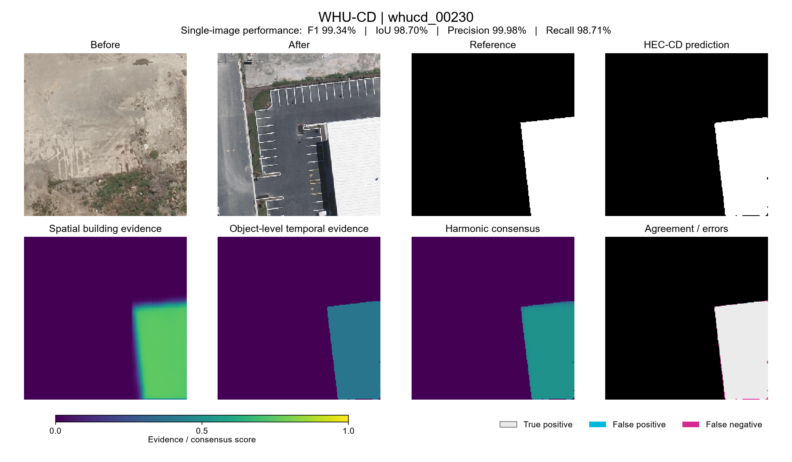

# Worked example

WHU-CD sample **whucd_00230** illustrates a successful building-change detection.
The single-image results are P **99.98%**, R **98.71%**, F1 **99.34%**, and IoU **98.70%**.



## Files

| File in `whu/` | Content |
|---|---|
| `before.png`, `after.png`, `reference.png` | Input pair and binary reference mask |
| `spatial_evidence.png`, `object_evidence.png` | Spatial building evidence and object-level temporal evidence, in uint8 units |
| `evidence_float32.npz` | Both evidence maps and harmonic consensus in float32, for exact numerical verification |
| `scores/whucd_00230.png` | Quantized harmonic consensus |
| `predictions/whucd_00230.png` | Final binary prediction (0/255) |
| `calibration.json` | Full 744-pair collection histogram and inclusive cutoff of 74 |
| `metrics.json` | Single-image pixel counts and metrics |

All maps are 256 x 256. Calibration uses the full collection's nonzero scores;
the reference mask is used only for evaluation. The preview uses a common 0-1
color scale for the evidence maps.

## Verify

Run from the repository root:

```python
import json
from pathlib import Path
import numpy as np
from PIL import Image
from hec_cd.core import harmonic_consensus, quantize, postprocess, select_unlabeled_histogram

root = Path('examples/whu')
record = json.loads((root / 'calibration.json').read_text())
cutoff = select_unlabeled_histogram(np.array(record['histogram'])).selected_u8
assert cutoff == record['selected_u8'] == 74
with np.load(root / 'evidence_float32.npz', allow_pickle=False) as evidence:
    fused = harmonic_consensus(evidence['spatial_evidence'], evidence['object_evidence'])
    assert np.array_equal(fused, evidence['harmonic_consensus'])
with Image.open(root / 'scores/whucd_00230.png') as image:
    score = np.asarray(image)
assert np.array_equal(quantize(fused), score)
with Image.open(root / 'predictions/whucd_00230.png') as image:
    assert np.array_equal(postprocess(score, cutoff), np.asarray(image) > 0)
```

The input imagery and reference mask are from the
[WHU Building Change Detection Dataset](https://study.rsgis.whu.edu.cn/pages/download/building_dataset.html)
and remain subject to its terms. See [Data preparation](../docs/data.md)
for the source images and test split.
